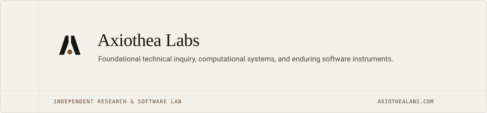

<picture>
  <source media="(prefers-color-scheme: dark)" srcset="./banner-dark.svg">
  
</picture>

 

**Axiothea Labs** is an independent research and engineering lab in Sri Lanka dedicated to foundational technical inquiry, computational systems, and enduring software instruments.

### Upcoming

- **Lith** (`In Development`) -- Lith is an offline darkroom app that processes photos with procedural film grain and analog print emulsions, or generates pure grain textures from scratch, with private local storage and print-ready exports.

### Practice

- **First-Principles Inquiry:** Careful technical research before writing tools around it.
- **Local-First Integrity:** Systems designed to hold ground offline, keeping user files on-device.
- **Built to Hold Weight:** Minimal dependencies and restrained interfaces built for longevity.

---

[axiothealabs.com](https://axiothealabs.com) &middot; [contact@axiothealabs.com](mailto:contact@axiothealabs.com)
